# lmshark

Packet capture analysis as a script: read and write `.pcap`/`.pcapng`, build exact packets, dissect them, follow TCP streams and filter with Wireshark-style expressions. MIT, one self-contained binary (dynamic glibc >= 2.35 on Linux, static C++/MinGW runtimes), no Wireshark or GPL code.

### TCP, packet by packet

| | |
| :--- | :--- |
| [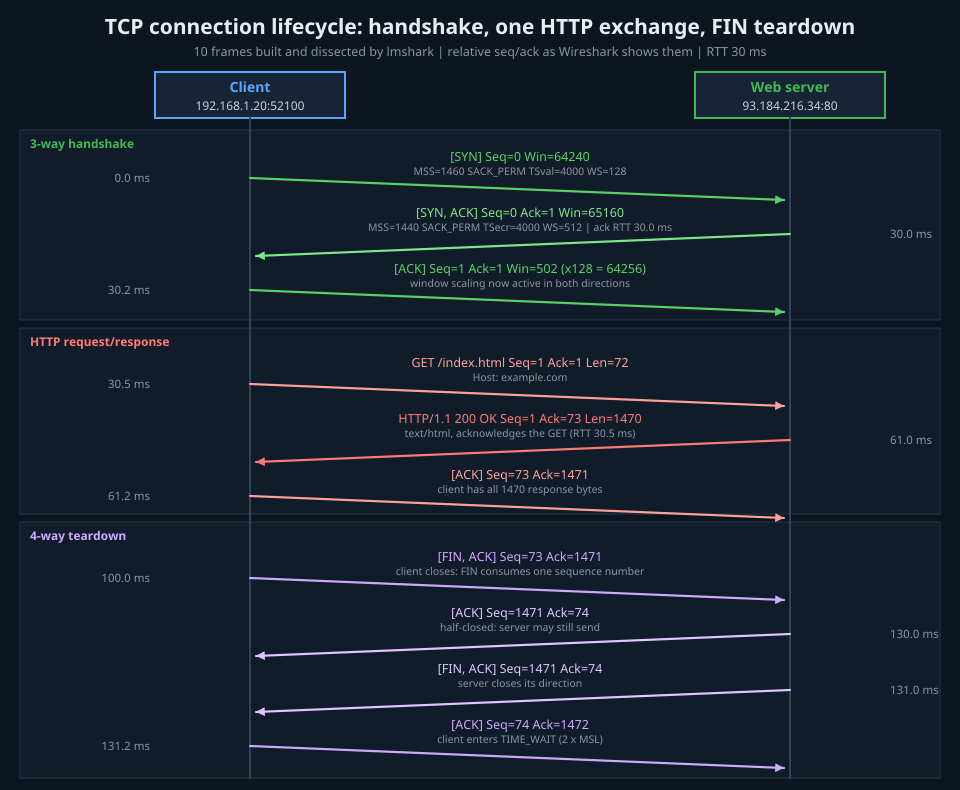](examples/tcp_handshake_teardown.lms)<br>**Handshake to teardown**<br>SYN options, one HTTP GET, FIN/ACK close; every seq/ack on the ladder is asserted.<br>`lmctl autorun https://raw.githubusercontent.com/lmctl-ai/lmshark/main/examples/tcp_handshake_teardown.lms` | [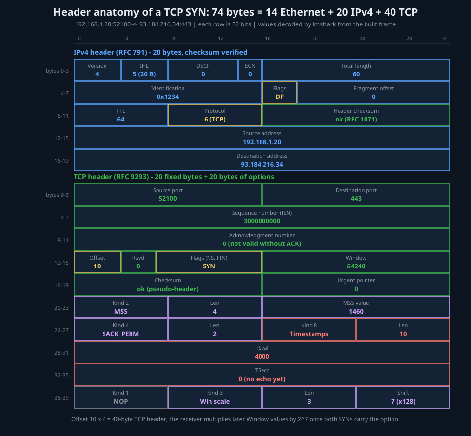](examples/header_anatomy.lms)<br>**Header anatomy**<br>IPv4 + TCP (with 20 bytes of options) of one real SYN, bit-accurate.<br>`lmctl autorun https://raw.githubusercontent.com/lmctl-ai/lmshark/main/examples/header_anatomy.lms` |
| [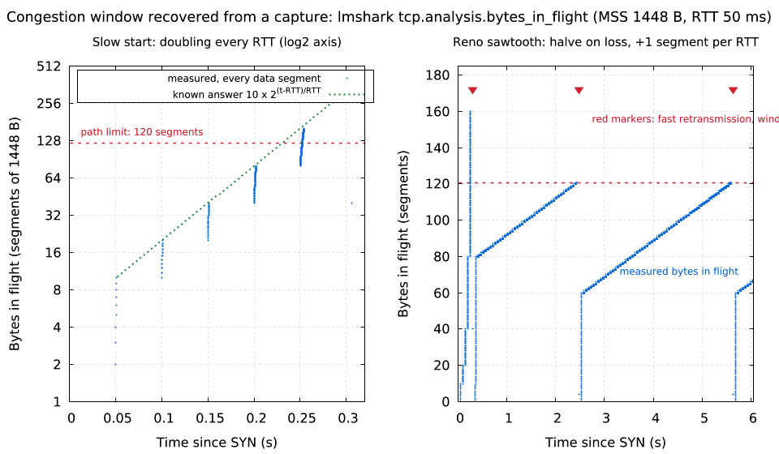](examples/slow_start_cwnd.lms)<br>**Slow start and the Reno sawtooth**<br>bytes_in_flight doubles per RTT (known answer), halves on fast retransmit.<br>`lmctl autorun https://raw.githubusercontent.com/lmctl-ai/lmshark/main/examples/slow_start_cwnd.lms` | [](examples/retransmission_storm.lms)<br>**Retransmission storm**<br>25 % Wi-Fi loss: duplicate ACKs, fast retransmissions, bursty goodput.<br>`lmctl autorun https://raw.githubusercontent.com/lmctl-ai/lmshark/main/examples/retransmission_storm.lms` |
| [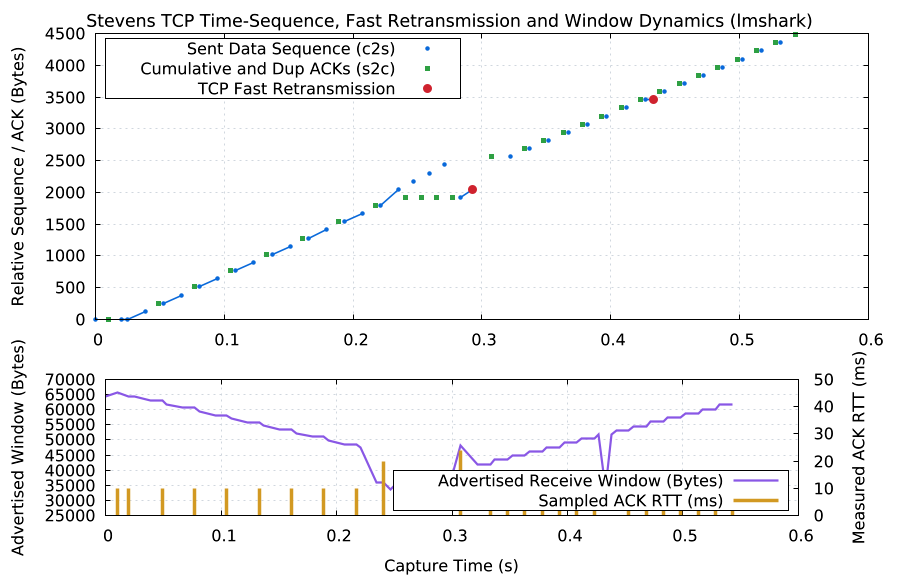](examples/tcp_stevens_graph.lms)<br>**Stevens time-sequence graph**<br>Dup ACKs, fast recovery, receive window and RTT samples.<br>`lmctl autorun https://raw.githubusercontent.com/lmctl-ai/lmshark/main/examples/tcp_stevens_graph.lms` | [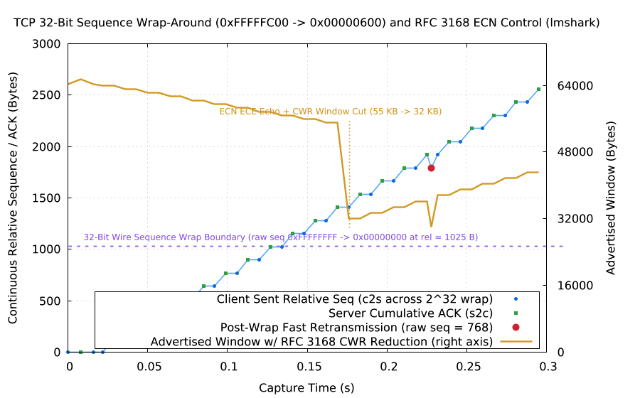](examples/gallery/tcp_seqwrap_and_ecn.lms)<br>**32-bit sequence wrap + ECN**<br>Relative sequence stays continuous across 2^32; CWR window cut.<br>`lmctl autorun https://raw.githubusercontent.com/lmctl-ai/lmshark/main/examples/gallery/tcp_seqwrap_and_ecn.lms` |

### Latency and loss

| | |
| :--- | :--- |
| [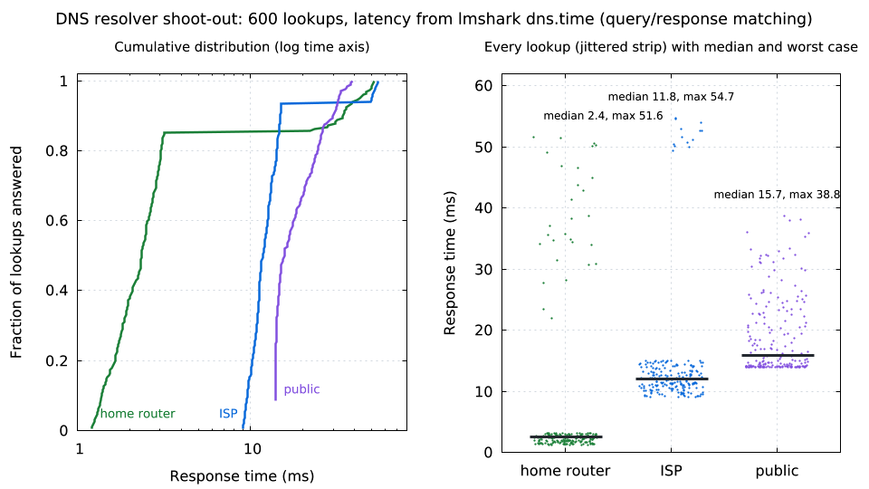](examples/dns_latency.lms)<br>**DNS resolver shoot-out**<br>600 lookups, dns.time CDF: cache hits vs misses vs anycast.<br>`lmctl autorun https://raw.githubusercontent.com/lmctl-ai/lmshark/main/examples/dns_latency.lms` | [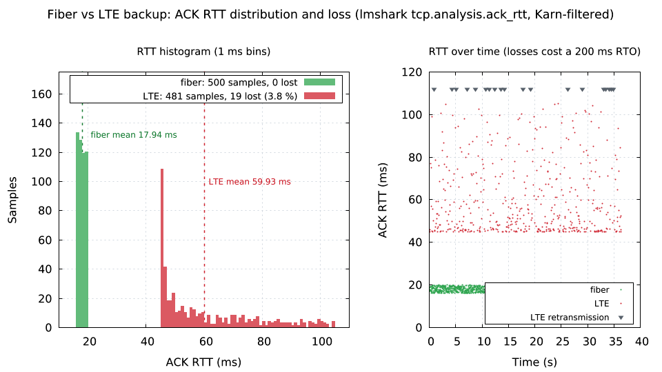](examples/packet_loss_rtt_histogram.lms)<br>**Fiber vs LTE backup**<br>ACK RTT histograms; Karn's rule skips retransmitted segments.<br>`lmctl autorun https://raw.githubusercontent.com/lmctl-ai/lmshark/main/examples/packet_loss_rtt_histogram.lms` |
| [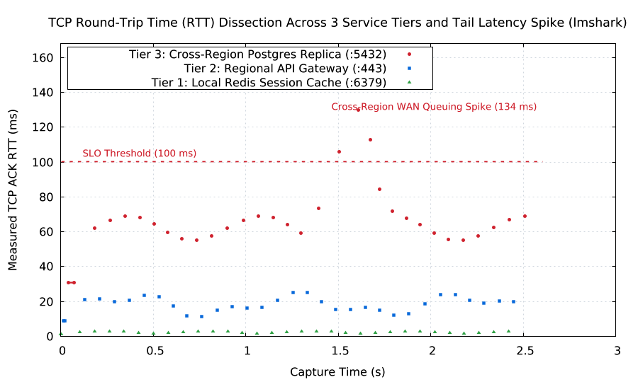](examples/rtt_distribution.lms)<br>**Three-tier RTT and a tail spike**<br>Per-stream ACK RTT against a 100 ms SLO.<br>`lmctl autorun https://raw.githubusercontent.com/lmctl-ai/lmshark/main/examples/rtt_distribution.lms` | [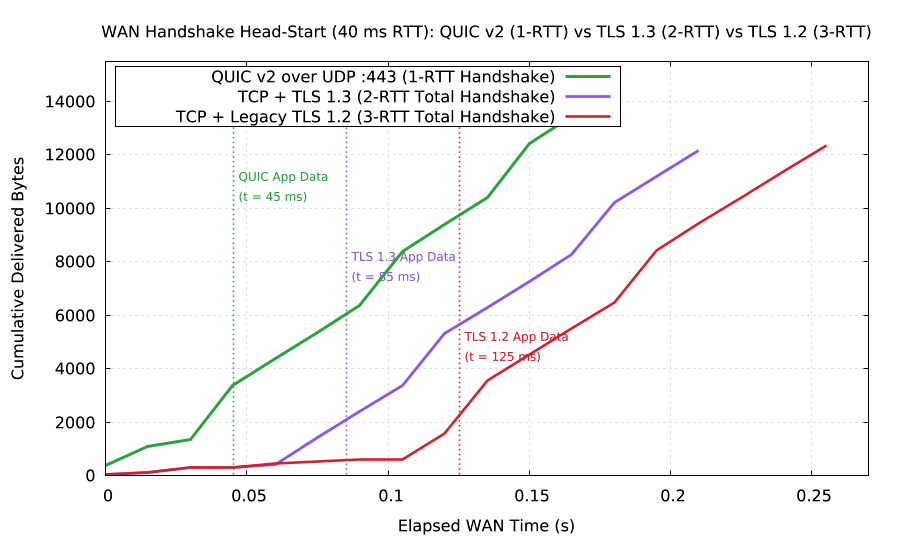](examples/gallery/quic_vs_tls_handshake.lms)<br>**QUIC vs TLS 1.3 vs TLS 1.2**<br>Time to first application byte over a 40 ms RTT.<br>`lmctl autorun https://raw.githubusercontent.com/lmctl-ai/lmshark/main/examples/gallery/quic_vs_tls_handshake.lms` |

### Security and inventory

| | |
| :--- | :--- |
| [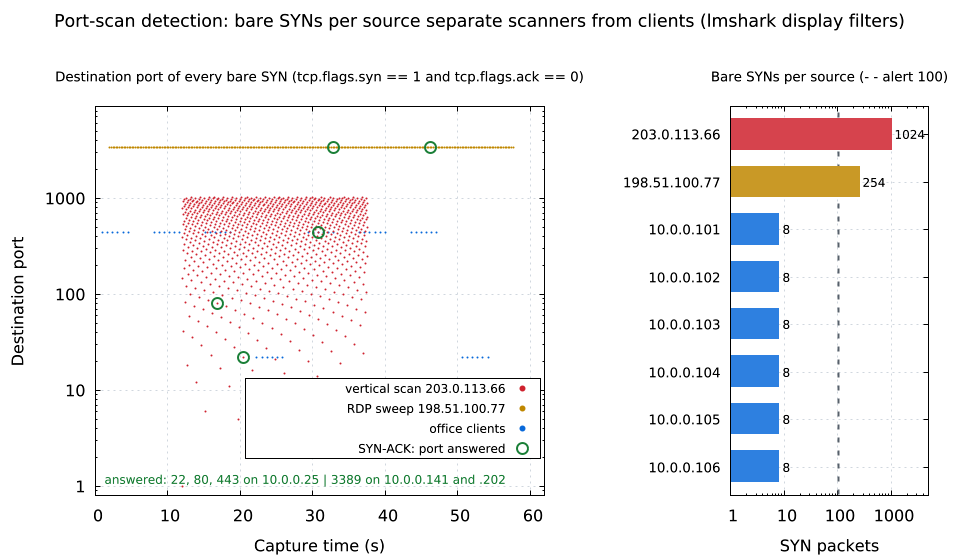](examples/port_scan_detection.lms)<br>**Port-scan detection**<br>Bare SYNs per source expose a vertical scan and an RDP sweep.<br>`lmctl autorun https://raw.githubusercontent.com/lmctl-ai/lmshark/main/examples/port_scan_detection.lms` | [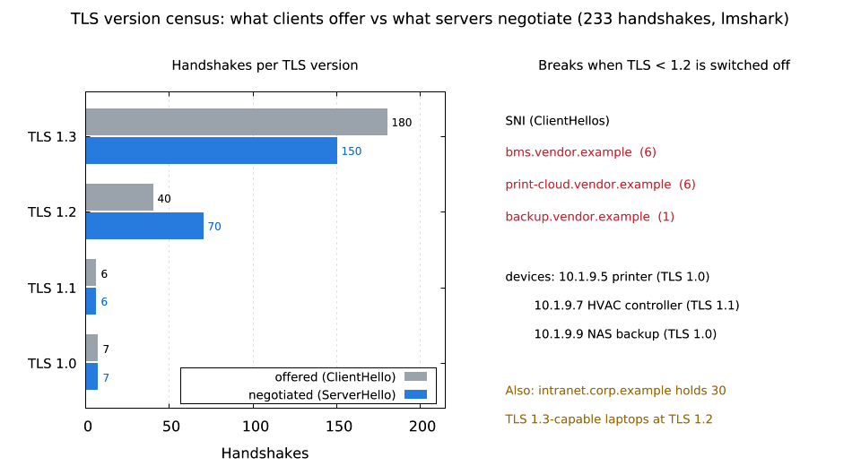](examples/tls_version_census.lms)<br>**TLS version census**<br>Offered vs negotiated versions; the devices TLS 1.0/1.1 shutdown breaks.<br>`lmctl autorun https://raw.githubusercontent.com/lmctl-ai/lmshark/main/examples/tls_version_census.lms` |
| [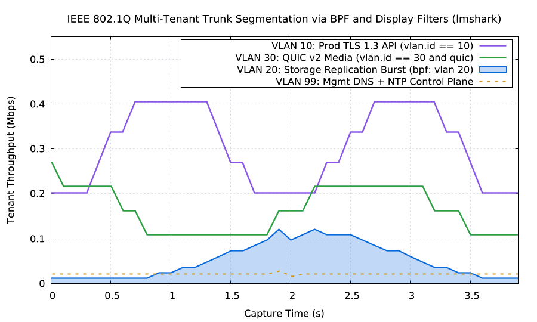](examples/gallery/vlan_segmentation.lms)<br>**802.1Q trunk segmentation**<br>Per-VLAN throughput with display and BPF filters.<br>`lmctl autorun https://raw.githubusercontent.com/lmctl-ai/lmshark/main/examples/gallery/vlan_segmentation.lms` | [](examples/gallery/ip_fragment_reassembly.lms)<br>**IPv4/IPv6 fragment reassembly**<br>Fragments stay at L3 until the chain completes.<br>`lmctl autorun https://raw.githubusercontent.com/lmctl-ai/lmshark/main/examples/gallery/ip_fragment_reassembly.lms` |

### Who talks to whom

| | |
| :--- | :--- |
| [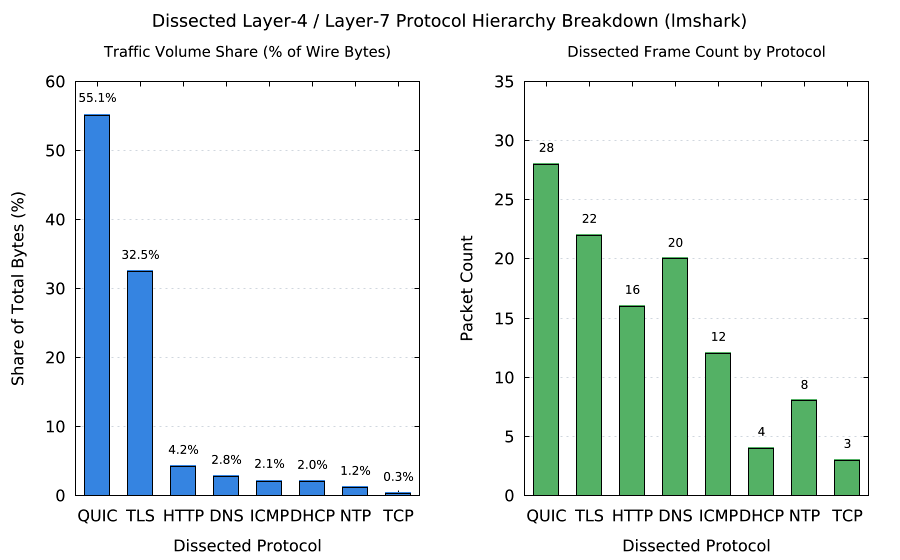](examples/protocol_hierarchy.lms)<br>**Protocol hierarchy**<br>Byte share pie vs packet counts per protocol.<br>`lmctl autorun https://raw.githubusercontent.com/lmctl-ai/lmshark/main/examples/protocol_hierarchy.lms` | [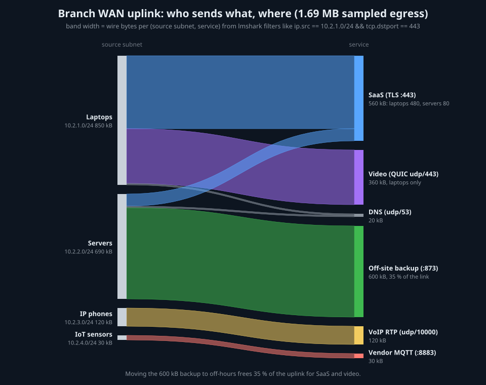](examples/flow_sankey.lms)<br>**WAN uplink flow diagram**<br>Source subnet to service, band width = wire bytes.<br>`lmctl autorun https://raw.githubusercontent.com/lmctl-ai/lmshark/main/examples/flow_sankey.lms` |
| [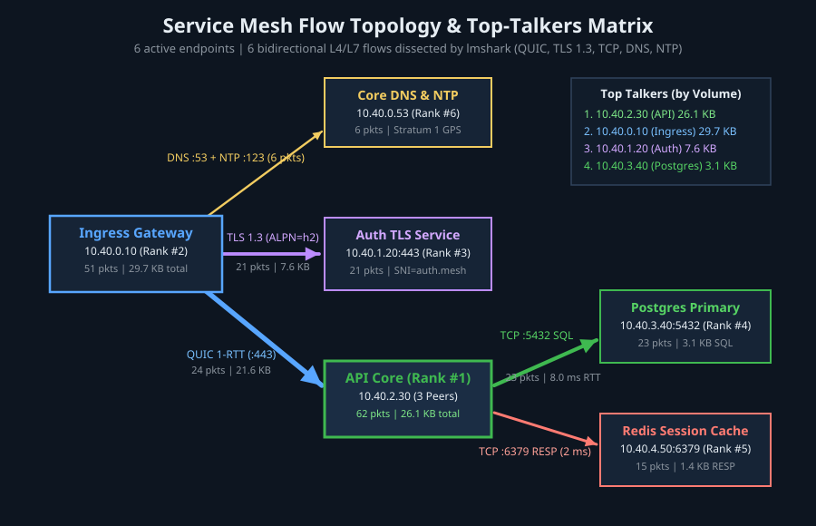](examples/top_talkers_topology.lms)<br>**Service-mesh top talkers**<br>Endpoints ranked by bytes, flows annotated with RTT.<br>`lmctl autorun https://raw.githubusercontent.com/lmctl-ai/lmshark/main/examples/top_talkers_topology.lms` | [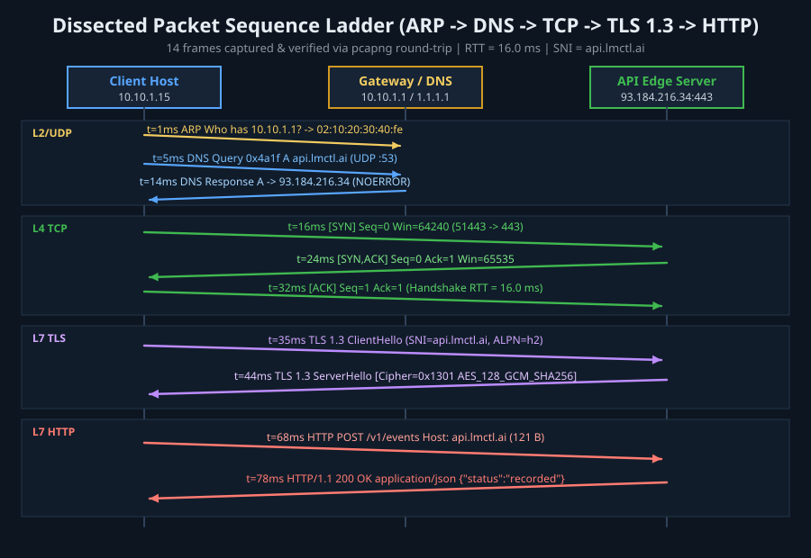](examples/protocol_sequence_ladder.lms)<br>**ARP to HTTP ladder**<br>ARP, DNS, TCP, TLS 1.3 and HTTP in one capture.<br>`lmctl autorun https://raw.githubusercontent.com/lmctl-ai/lmshark/main/examples/protocol_sequence_ladder.lms` |
| [](examples/io_traffic_sweep.lms)<br>**Animated I/O graph**<br>Throughput per protocol sweeping over time (GIF).<br>`lmctl autorun https://raw.githubusercontent.com/lmctl-ai/lmshark/main/examples/io_traffic_sweep.lms` | [](examples/io_traffic_sweep.lms)<br>**I/O graph with retransmission burst**<br>Mbit/s per 100 ms and a retransmission spike.<br>`lmctl autorun https://raw.githubusercontent.com/lmctl-ai/lmshark/main/examples/io_traffic_sweep.lms` |

Each picture is made by the example it links to: the script builds its own capture (no downloads),
asserts the numbers it shows against lmshark's dissection, then draws with
[lmplot](https://github.com/lmctl-ai/lmplot) or [lmdraw](https://github.com/lmctl-ai/lmdraw).
Run the command under a picture in an empty directory; the PNG lands in `images/`.

## Quickstart (1 minute)

Install [lmctl](https://github.com/lmctl-ai/lmscript) and run any caption above (on Linux x64/arm64, release binaries require dynamic glibc >= 2.35 and statically link libstdc++/libgcc; macOS arm64/x64 and Windows x64 require no extra runtime packages), or write a script:

```lms
p = _dsl_ cli="lmshark" install="github:lmctl-ai/lmshark@latest";
let c = shark.capture();
c.tcp_segment_opts(0.000, "10.0.0.1", 40000, "93.184.216.34", 443, 1000, 0, "SYN", 64240, "mss=1460,sack_perm,wscale=7", "");
c.tcp_segment_opts(0.030, "93.184.216.34", 443, "10.0.0.1", 40000, 5000, 1001, "SYN,ACK", 65535, "mss=1400,wscale=8", "");
c.tls_client_hello(0.031, "10.0.0.1", 40000, "93.184.216.34", 443, 1001, 5001, "example.com", "1.3", "h2");
c.dns_query(0.040, "10.0.0.1", 5353, "1.1.1.1", 7, "example.com", "A");
c.dns_response(0.052, "1.1.1.1", "10.0.0.1", 5353, 7, "example.com", "A", "93.184.216.34", 0);
assert_eq(c.pkt_field(1, "tcp.analysis.ack_rtt"), "30.000");
assert_eq(c.count("tls.sni == \"example.com\" && tcp.port in {443 8443}"), 1);
assert_eq(c.pkt_field(4, "dns.time"), "12.000");
c.save_pcapng("hello.pcapng");   # opens in Wireshark and tcpdump
c.save_fields_csv("tcp", "frame.time,ip.src,tcp.flags,tcp.options.mss_val", "tcp.csv");
end _dsl_
savedsl(p, "hello.dslb");
r = system ${dsl_cli(p)} --dsl hello.dslb;
assert(r.code == 0);
```

`lmscript hello.lms` compiles the block against the host schema; the `system` line runs it. Reading an
existing capture is `let c = shark.open("trace.pcapng");`.

## What it does

- **Files**: pcap (us and ns magic, both byte orders) and pcapng (SHB/IDB/EPB/SPB, `if_tsresol`, `if_tsoffset`,
  several interfaces). Timestamps are kept as exact integer nanoseconds; writers pick the ns format only when needed.
  Link types: Ethernet (1), raw IP (101), Linux cooked SLL (113), BSD loopback (0).
- **Dissectors**: Ethernet, 802.1Q and 802.1ad QinQ, ARP, IPv4 (+fragments), IPv6 (+extension headers and fragments),
  ICMP, ICMPv6/NDP, TCP (+MSS, window scale, SACK, timestamps), UDP, DNS (all answer records, compression), HTTP/1.x,
  TLS ClientHello/ServerHello (SNI, ALPN, versions 1.0-1.3), DHCP, NTP, QUIC long/short headers. Checksums are verified.
- **TCP analysis**: streams, relative seq/ack, retransmission, fast retransmission, out-of-order, duplicate ACK,
  zero window, ACK RTT (Karn's rule), bytes in flight, newly acked bytes, scaled window, stream reassembly
  (out-of-order and overlapping segments, first copy wins, gaps marked `[<N bytes missing>]`).
- **Display filters**: `==  !=  <  <=  >  >=  contains  matches (~)  in {a b lo..hi}`, `&& || !` (and/or/not) with
  `!` > `&&` > `||` precedence, IPv4 CIDR on `ip.addr`/`ip.src`/`ip.dst`, multi-valued fields (`ip.addr`, `tcp.port`,
  `vlan.id`, `dns.a`). Unknown field names are errors, never silent mismatches. `contains` is case-sensitive;
  `matches` is an ECMAScript regex, `(?i)` prefix for case-insensitive.
- **Capture filters**: a BPF subset (`host`, `net`, `port`, `portrange`, `tcp`/`udp`/`icmp`, `vlan`, `src`/`dst`).
- **Exports**: pcap, pcapng, packet/flow/top-talker/protocol-hierarchy/I-O-graph/time-sequence CSV, JSON, and
  `save_fields_csv` (like `tshark -T fields`) / `save_field_counts_csv` (group-by counts) for any filter.

## API (`context shark: Shark`)

- `shark.capture() -> Capture`, `shark.open(path) -> Capture`
- Builders: `set_macs`, `set_vlan(id)`, `set_qinq(outer, inner)`, `clear_vlan`, `raw_frame(ts, hex, linktype)`,
  `ipv4_fragment`, `ipv6_fragment`, `arp_request`, `arp_reply`, `icmp_echo_request/reply`, `icmp_time_exceeded`,
  `icmp_dest_unreachable`, `icmpv6_echo_request/reply`, `icmpv6_neighbor_solicit/advert`,
  `tcp_segment(ts, src, sport, dst, dport, seq, ack, flags, window, payload)`,
  `tcp_segment_opts(..., window, "mss=1460,sack_perm,ts=TSVAL/TSECR,nop,wscale=7,sack=L-R;L-R", payload)`,
  `tcp6_segment`, `tcp_handshake`, `tcp_close`, `udp_datagram`, `udp6_datagram`, `dns_query`, `dns_response`,
  `http_request`, `http_response`, `tls_client_hello`, `tls_server_hello`, `tls_app_data`, `dhcp_message`,
  `ntp_packet`, `quic_initial`, `quic_handshake`, `quic_short`
- Queries: `packet_count`, `total_bytes`, `duration`, `protocol_packets/bytes(proto)`, `count(filter)`,
  `tcp_stream_count`, `retransmission_count`, `out_of_order_count`, `dup_ack_count`, `avg/min/max_rtt_ms`,
  `flow_count`, `unique_hosts`, `summary`, `pkt_time/len/linktype/proto/src/dst/srcport/dstport/vlan/info(i)`,
  `pkt_field(i, field)`, `tcp_stream_text/bytes(stream, "client"|"server"|"both")`,
  `tcp_stream_packets/retransmissions/rtt_ms(stream)`
- Slicing: `filter(display)`, `bpf(capture_filter)`, `slice_time(t0, t1)`, `merge(other)`
- Exports: `save_pcap`, `save_pcapng`, `save_packets_csv`, `save_flows_csv`, `save_top_talkers_csv`,
  `save_protocol_hierarchy_csv`, `save_io_graph_csv(bucket_s, path)`, `save_time_sequence_csv(stream, path)`,
  `save_json`, `save_fields_csv(filter, "f1,f2,...", path)`, `save_field_counts_csv(filter, field, path)`

Fields (for `pkt_field`, filters and field lists) follow Wireshark names where one exists: `frame.*`, `eth.*`,
`vlan.id/inner_id/count`, `arp.*`, `ip.*` / `ipv6.*` (incl. fragment and checksum fields), `icmp*`, `tcp.srcport/
dstport/port/seq/ack/rel_seq/rel_ack/len/hdr_len/flags(.syn/.ack/.fin/.rst|reset/.psh|push/.urg/.ece/.cwr/.ns)/
window_size/window_size_value/stream/checksum_ok`, `tcp.options.mss_val/wscale.shift/wscale.multiplier/sack_perm/
sack/timestamp.tsval/timestamp.tsecr`, `tcp.analysis.retransmission/fast_retransmission/out_of_order/duplicate_ack/
zero_window/ack_rtt/bytes_in_flight/acked_bytes`, `udp.*`, `dns.qry.name/qry.type/a/aaaa/cname/answer/
count.answers/flags.rcode/flags.response/id/time`, `http.request.method/request.uri/host/response.code/...`,
`tls.sni/version/record.version/alpn/cipher_suite/handshake.type`, `dhcp.*`, `ntp.*`, `quic.*`.
`lmshark --dsl-schema` prints every method signature.

## Limits (honest list)

- File analysis only: no live capture.
- Not every Wireshark field or protocol exists (no HTTP/2, gRPC, SMB, routing protocols); TLS is parsed up to the
  hellos; QUIC payloads are not decrypted. Unknown fields are reported as errors.
- TCP analysis follows Wireshark's ideas but is simpler: no keep-alive, window-full or spurious-retransmission
  classes; fast retransmission needs two or more duplicate ACKs naming that sequence number.
- The capture is held in memory; the budget is `LMSHARK_MAX_MEMORY_MB` (default 4096 MiB), exceeding it stops the
  script with exit code 3 and a message on stderr.
- `lmctl autorun` installs the latest released lmshark; examples that use API added after that release need the next
  release (or a local build on `PATH`).

## Relationship to Wireshark

Wireshark, libwireshark and tshark are GPLv2+. lmshark is an original MIT implementation written from the RFCs and
IEEE specifications, links nothing from them, and only borrows their *field names* so filters feel familiar. Files it
writes open in Wireshark and tcpdump. See [THIRD_PARTY_NOTICES](THIRD_PARTY_NOTICES).

## Build and test

```bash
cmake -S . -B build -DCMAKE_BUILD_TYPE=Release && cmake --build build -j
./test.sh                  # native tests, every tests/*.lms suite (compiled and run), error paths, examples
./examples/render-all.sh   # regenerate docs/images/ (needs lmplot, lmdraw, ffmpeg)
```

## License

MIT, see [LICENSE](LICENSE).
